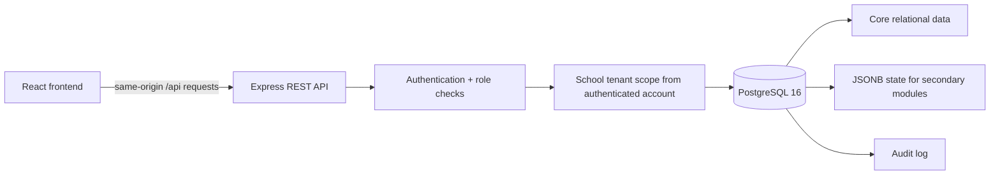
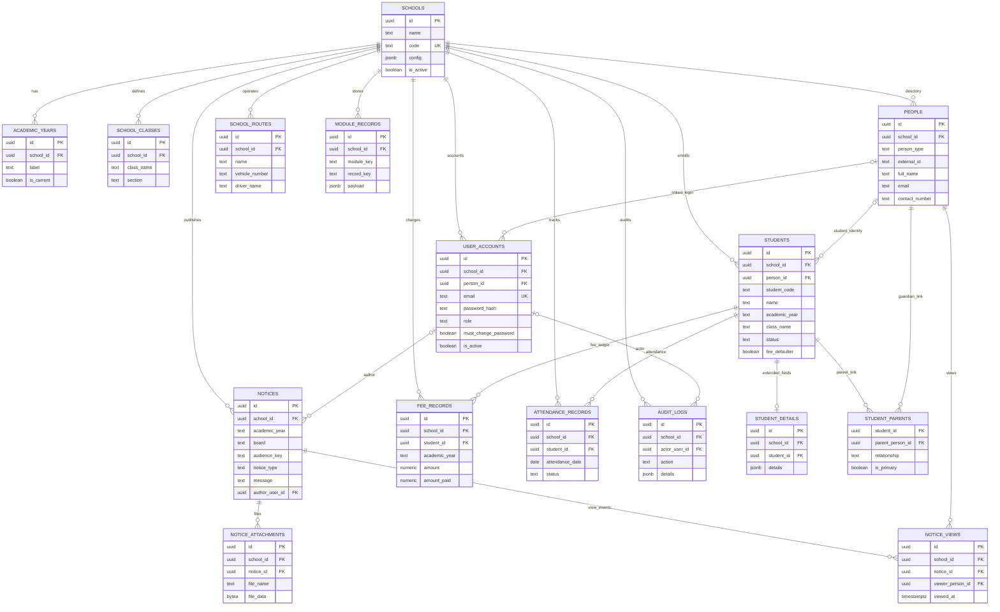

# School Diary — Database Architecture

## 1. Architecture overview

## 2. Entity relationship diagram

## 3. Table responsibilities

| Table | Responsibility | Implementation |
|---|---|---|
| `schools` | Tenant, school name/code/contact/configuration | Relational tenant root |
| `academic_years` | School-specific years and current-year flag | Relational |
| `school_classes` | Configured class/section options | Relational |
| `people` | Identities for students, parents, teachers, staff, guardians and other recipients | Relational |
| `user_accounts` | Login, role, hashed password, activation and forced password change | Relational |
| `students` | Student listing, photo, identity, contact, class/year, flags and metadata | Relational + metadata JSONB |
| `student_details` | Additional edit form fields not normalized to student columns | JSONB per student |
| `student_parents` | Student-to-parent links, relationship and primary-contact flag | Relational bridge |
| `school_routes` | Routes, stops, vehicle, driver and activation | Relational |
| `notices` | Notice year/category/audience/type/message/author/reply permission | Relational |
| `notice_attachments` | Attachment name, MIME type, size and binary content | Relational; bytes in PostgreSQL for this starter |
| `notice_views` | First read timestamp per unique notice/person pair | Relational, unique constraint prevents duplicate unique-view counts |
| `fee_records` | Student fee charges, payments, due date and reference | Relational |
| `attendance_records` | Attendance status per student/date | Relational |
| `events`, `messages` | Event and message primitives | Relational |
| `questionnaires`, `questionnaire_responses` | Questionnaire definitions and responses | Relational + JSONB answers/options |
| `store_inventory`, `store_vendors` | Inventory and vendor records | Relational + metadata JSONB |
| `module_records` | State for secondary modules not yet normalized to domain-specific entities | JSONB per school/module key |
| `audit_logs` | Important account, school setting, notice and fee changes | Relational audit trail |
| `schema_migrations` | Version ledger maintained by the migration runner | Relational |

## 4. Design rules

- **Tenant isolation:** each school-owned entity stores `school_id`. API routes resolve school scope from the authenticated account rather than trusting a request body. Queries should constrain both primary rows and joined rows to the authenticated tenant.
- **Identity versus login:** `people` stores real-world recipients; `user_accounts` supplies optional login access. A recipient can be registered before an account is created.
- **Notice eligibility:** notices target school, class or route through `board` and `audience_key`. `eligiblePeople()` calculates the recipient directory from the student, guardian and route mappings. Notice views are only recorded for authenticated eligible identities.
- **Unique notice view:** `notice_views` uses `UNIQUE(notice_id, viewer_person_id)`, so repeated opens don't increase unique view counts.
- **Server-owned database:** browser code only calls `/api`; DB credentials remain inside server/Docker configuration.
- **Core + flexible data:** important flows use relational tables and APIs. Some generic module state remains JSONB in `module_records`. Normalize those workflows as they mature and require complex querying/reporting.
- **Files:** student photos and notice attachments are stored in PostgreSQL in this starter. For large production use, store binary objects in private object storage and retain keys/metadata in PostgreSQL.

## 5. Indexes and common queries

`schema.sql` creates indexes for school/year/class, school/status, case-insensitive student name, people type/class, people route, notices by school/year/date, notices by category/audience, notice views by school/notice, and audit log chronology. Add indexes based on observed production query plans and query latency rather than indexing every field.

## 6. Migration workflow

The migration runner creates `schema_migrations` and applies `server/migrations/001_initial_schema.sql` once, inside a transaction. Never edit an already-applied migration in a live environment. Add `002_descriptive_change.sql`, include it in the ordered migration list in `server/migrate.js`, and update this document. `server/schema.sql` remains the complete snapshot used for review; the initial migration must stay identical to that baseline until new migration files introduce later changes.
