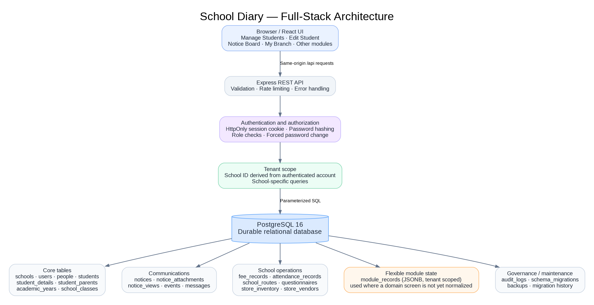
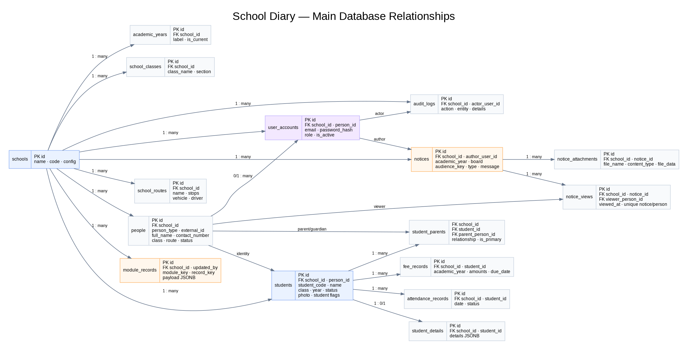
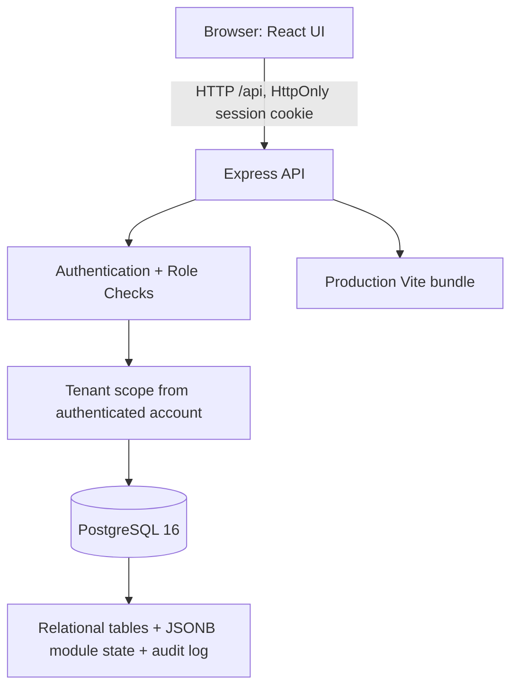

# School Diary — Full-Stack Edition

This is a **separate full-stack edition** of the School Diary prototype. The prior standalone ZIP remains unchanged. This version runs a React/Vite frontend, an Express API, and PostgreSQL through Docker Compose. Student records, student details, routes, fees, attendance, notices, attachments, notice views, recipients, user accounts, school settings, and generic module state are persisted in the database.

> This is a deployable starter implementation, not a completed production rollout. Before using real student data, deploy behind HTTPS, change all initial passwords, configure backups/monitoring, review privacy/legal obligations, and complete end-to-end browser/UAT and security testing.

## Architecture








Visual architecture: [`docs/diagrams/system-architecture.png`](docs/diagrams/system-architecture.png). Entity relationship diagram: [`docs/diagrams/entity-relationships.png`](docs/diagrams/entity-relationships.png). Detailed design: [`docs/DATABASE_ARCHITECTURE.md`](docs/DATABASE_ARCHITECTURE.md). Root-level schema copy: [`database/school_diary_postgresql_schema.sql`](database/school_diary_postgresql_schema.sql). API reference: [`docs/API_REFERENCE.md`](docs/API_REFERENCE.md). Screen-to-database map: [`docs/SCREEN_TO_DATABASE_MAP.md`](docs/SCREEN_TO_DATABASE_MAP.md). Before real use, follow [`docs/INTEGRATION_ACCEPTANCE_CHECKLIST.md`](docs/INTEGRATION_ACCEPTANCE_CHECKLIST.md). See [`docs/OPERATIONS_AND_SECURITY.md`](docs/OPERATIONS_AND_SECURITY.md) for backup and deployment guidance.

## Requirements

- Windows 10/11 or Linux/macOS.
- Docker Desktop / Docker Engine with Docker Compose v2. Docker runs Node and PostgreSQL in containers, so installing Node.js locally is not required for the normal Windows launch process.
- Port `3001` available for the app and the Docker-managed database port is not published to the host by default.

## Quick start on Windows

1. Extract the ZIP into a new folder. Keep your prior standalone version separately.
2. Double-click `START-FULL-STACK.bat`.
3. On the first run, Docker downloads the PostgreSQL image and builds the frontend/API image. This can take several minutes and needs an internet connection for the first image/package downloads.
4. The browser opens at `http://localhost:3001`.
5. Sign in with the first-run credentials listed below and immediately change the temporary password when prompted.

First-run demo credentials (change these before using any real data):

| Role | Email | Initial password |
|---|---|---|
| Super Admin | `superadmin@schooldiary.local` | `SuperAdmin123!` |
| Sanford School Admin | `admin@sanford.local` | `ChangeMe123!` |

The initial users require a password change. If you edit the credentials in `.env`, remember that seed accounts are only created when the configured email does not already exist. Existing account passwords are not reset by changing `.env`.

To stop the containers, double-click `STOP-FULL-STACK.bat`. The PostgreSQL volume is retained so your data persists. To intentionally remove the database volume and **permanently delete all local database data**, run `docker compose down -v` from the project folder. Do not do this if you need the data.

## Configuration

On first launch, `START-FULL-STACK.bat` copies `.env.example` to `.env` and generates a JWT secret. Edit `.env` to configure `DEFAULT_SCHOOL_NAME`, `DEFAULT_SCHOOL_CODE`, bootstrap account emails/passwords and database credentials. Keep `.env` private and do not commit or share it.

- For local `http://localhost:3001`, `COOKIE_SECURE=false` is required so the browser can send the session cookie.
- For production behind valid HTTPS, set `COOKIE_SECURE=true`, provide a unique random `JWT_SECRET` of at least 32 characters, use strong database passwords, configure the allowed origin/reverse proxy, and terminate TLS at the proxy. Do not expose PostgreSQL to the public internet.
- `SEED_DEMO_DATA=true` creates a demo school, initial accounts, academic years, demo students/routes and sample notices if missing. For a fresh production installation, review `server/seed.js` and disable demo seeding after the intended tenant/admin setup is in place.

## Account and tenant model

- A `school` is the tenant boundary. School-specific tables carry `school_id`; API routes derive school scope from the authenticated database account and reject cross-school access.
- `super_admin` can create school accounts; a `school_admin` or `principal` manages only its school.
- People (students, parents, teachers, staff, guardians, day-care recipients) can exist without a login. Contacts provides the Recipient Directory and the linked account workflow.
- A new account can require a temporary password reset. Share the temporary password securely and ask the recipient to change it immediately.
- Parent/student role endpoints restrict records to linked person relationships where implemented. Complete role-by-role UAT is a mandatory pre-production step.

## Data import

From Manage Students, use the existing student CSV template/export-import workflow. The backend validates headers, limits imports to 2,000 rows per request, and performs upserts within the authenticated school tenant. For other schools, first create the tenant and accounts in the Super Admin flow; sign in as that school, then import its students.

For existing 75-student template rows, the bootstrap seed adds the sample rows for Sanford School if they do not already exist. This is demonstration data; review/remove it when setting up a real school.

## Persistence status by module

- First-class database tables and APIs: authentication/accounts, school settings, students, additional student details, academic years/classes, directory people and links to parents, notice records, notice attachments, notice-view events and CSV viewer reports, transport routes, fee records and attendance records.
- Less mature module pages persist their current module payload in `module_records` as JSONB scoped by school and module key (examples include Events, generic Messages, My Branch configuration, questionnaires UI state, store UI state and day-care state). This prevents browser-only storage for those module payloads, but does **not** yet provide normalized per-record/domain workflows for every submodule.
- Student photos and notice file attachments are currently stored in database fields (`photo_data_url` and `notice_attachments.data`). For large production deployments, move files to private object storage and save metadata/keys in PostgreSQL.
- Notice view events are unique per notice/person; the UI uses a signed-in recipient identity and checks notice audience eligibility. Cross-device view synchronization requires all viewers to use their own linked account.

## AWS normalized database target (not yet active)

The proposed AWS target schema and the required security/migration plan are tracked separately:

- [Normalized AWS PostgreSQL schema — no JSON/JSONB data columns](database/aws_school_world_relational_schema.sql)
- [Schema design, ERP page mapping, input types and security guide](docs/AWS_RELATIONAL_SCHEMA_GUIDE.md)
- [Post-install schema validation checks](database/aws_schema_validation.sql)

**Important:** these files describe the destination design, not a live database. The current Express API and existing migrations still depend on the legacy JSONB tables and database-stored file data. Do not apply this target schema to Railway or point the running application at a database containing only the new schema. The API/data migration, S3 file migration, tenant-context setup for row-level security, and regression testing must be completed before cutover.

## Development mode

For advanced local development outside Docker, install PostgreSQL separately, create a database/user, and edit `DATABASE_URL` in `.env` to use the database host accessible from your workstation (for example `localhost` rather than Docker's `db` service name). Then run:

```bash
npm install
npm run db:migrate
npm run db:seed
npm run dev
```

Vite runs the UI on port `5173` and proxies `/api` to port `3001`. Production is served by the Express server on port `3001` after `npm run build`. The supported beginner path is `START-FULL-STACK.bat`, which runs the application and PostgreSQL together in Docker Compose.

## Verification notes

The source has been syntax-checked using the installed TypeScript JSX parser, Node's syntax check, CSS parsing checks, schema/migration comparisons, and ZIP integrity checks. This environment did not have Docker or PostgreSQL installed, and dependency installation did not complete, so a fully running browser-plus-database acceptance test could not be performed here. Follow the local run instructions and complete the validation checklist in `docs/OPERATIONS_AND_SECURITY.md` before real use.
